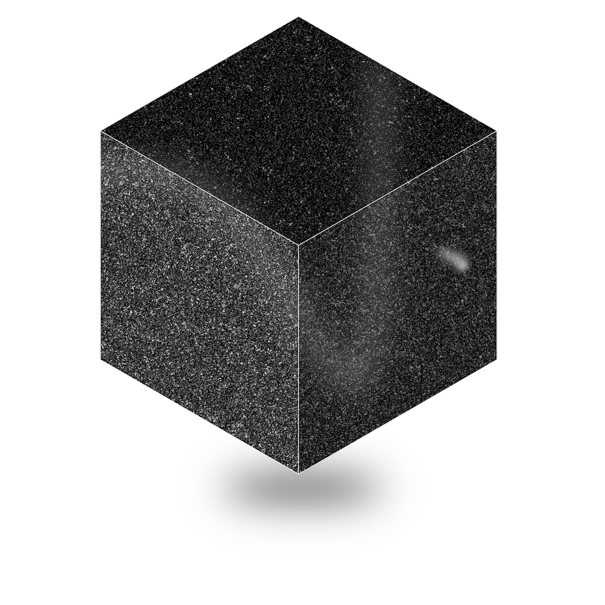

# Welcome to DarkOS.

	

Use AI agents on your codebase, checkpoint and visualize changes, and bring any model or host locally. DarkOS sends messages directly to providers without retaining your data.

This repo contains the full sourcecode for DarkOS Desktop app.

- 🔨 [Contribute](https://github.com/pedro2rafael4561-boop/DarkOS/blob/main/HOW_TO_CONTRIBUTE.md)
- 📖 [Codebase Guide](https://github.com/pedro2rafael4561-boop/DarkOS/blob/main/DARKOS_CODEBASE_GUIDE.md)
- 🛠️ [Builder Repo](https://github.com/pedro2rafael4561-boop/DarkOS-builder)
- 📦 [Versions Repo](https://github.com/pedro2rafael4561-boop/DarkOS-versions)

## Features

- Mounts React + Tailwind inside the VS Code workbench.
- Standalone builder pipeline to package, sign, and auto-update DarkOS across Windows, macOS, and Linux.
- Custom AI provider architecture supporting autocomplete (FIM), inline edit (Ctrl+K), and chat (Ctrl+L).
- Custom services to edit files with streaming diffs.

## Reference

DarkOS is a custom AI-first editor forked from VS Code. For a guide to our codebase, see [DARKOS_CODEBASE_GUIDE](https://github.com/pedro2rafael4561-boop/DarkOS/blob/main/DARKOS_CODEBASE_GUIDE.md).
For building binaries, see [DarkOS-builder](https://github.com/pedro2rafael4561-boop/DarkOS-builder).
